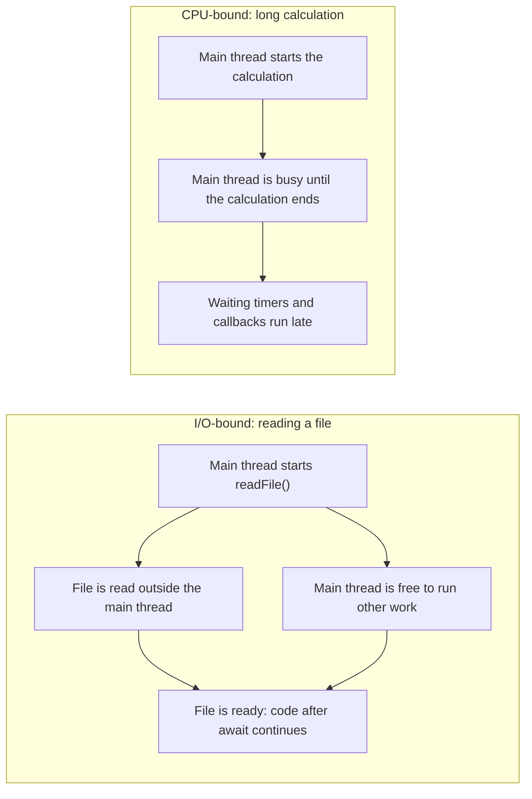

# CPU-Bound vs I/O-Bound Work in Node.js
## What CPU-bound work means

CPU-bound work is work where the program spends most of its time computing. The speed is limited mainly by the processor (CPU).

Examples: large calculations, processing big arrays of data, resizing images, and encryption.

In this project, adding every number from 1 to 100,000,000 is CPU-bound work.

## What I/O-bound work means

I/O-bound work (input/output) is work where the program spends most of its time waiting for something outside itself to respond, such as the disk, the network, or a database. The speed is limited mainly by that external system, not by the processor.

Examples: reading or writing files, calling an API over the internet, and querying a database.

In this project, reading `data/sample.txt` is I/O-bound work.

## How asynchronous I/O works

When the program starts an asynchronous I/O operation, such as `readFile()` from `node:fs/promises`, the function does not return the file contents immediately. Instead, it returns a promise, which works like an order token: "your result is on its way."

The actual reading is handled outside the main JavaScript thread, by Node.js and the operating system. Meanwhile, the main thread is free to run other JavaScript.

When the read finishes, the promise is fulfilled with the result. Code that used `await` on that promise then continues from where it paused.

Experiment 1 showed this: message 2 ("Doing other work") printed before the file contents arrived.

## Why CPU-intensive work blocks the event loop

Node.js runs JavaScript on a single main thread. The event loop is how that thread picks the next job to run: a finished file read, a timer, or an incoming request.

The event loop can only pick the next job after the current JavaScript code finishes. A long synchronous calculation keeps the main thread busy, so the event loop cannot run anything else until the calculation ends. Other jobs are not lost; they wait in line, and they run late.

Experiment 3 showed this: a timer requested for 10 ms was handled after about 224 ms, because the main thread was busy adding numbers for about 215 ms.

## Why async and await do not move CPU work to another thread

Marking a function `async` does not make it run on another thread. When an async function is called, its code starts running immediately on the main thread. It only pauses at an `await` on a promise that is still pending.

For I/O, such as `readFile()`, the waiting happens outside the main thread, so `await` lets the main thread do other work in the meantime.

A CPU-intensive loop has nothing to wait for. Even inside an `async` function, the loop runs from start to finish on the main thread, and the returned promise is only fulfilled after the loop has finished. Other jobs, such as timers, still have to wait.

To run CPU-intensive JavaScript without blocking the main thread, the work must be moved to a separate thread, for example with Worker Threads.

## When to investigate I/O vs CPU performance

When an application is slow, the first step is to find out whether it is busy computing or busy waiting.

**Investigate CPU performance when:**

- CPU usage is high, close to 100%.
- Timers and other callbacks run later than expected (event loop delay increases).
- Even simple requests become slow while heavy work is running.

**Investigate I/O performance when:**

- CPU usage is low, but responses are still slow.
- Most of the time is spent waiting for a disk, a network service, or a database.
- Slowness depends on file sizes, network speed, or database response times.

In both cases, measure before changing anything. Measurements show where the time is really going, and confirm whether a fix actually helped.

## Diagram: waiting vs computing
The diagram below compares what the main thread does during asynchronous I/O and during a long synchronous calculation.

